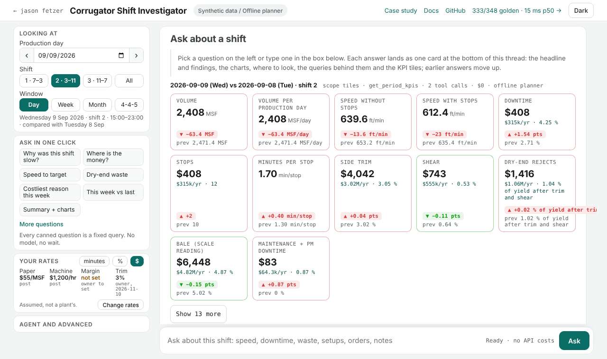
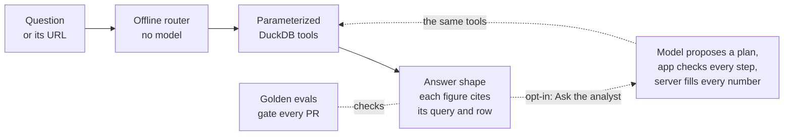

# Corrugator Shift Investigator

A bounded agent that tells corrugated production staff why a shift went bad (the downtime, the speed against each grade, the waste) from synthetic corrugator records, with a receipt for every number.

**Live: <https://shift.talktomymachine.ai>** · [Case study](https://shift.talktomymachine.ai/docs/case-study) · [Golden evals](https://shift.talktomymachine.ai/evals) · [Docs](https://shift.talktomymachine.ai/docs) · [Run it locally](#run-it-locally)



## Ask it yourself

- [Why was third shift slow on 10 September?](https://shift.talktomymachine.ai/corr/1/day/2026-09-10/shift/3?measure=overview): speed against each grade's target, the biggest stop reason and the slowest run.
- [Which downtime reason cost the most minutes that week?](https://shift.talktomymachine.ai/corr/1/day/2026-09-09/shift/2?measure=pareto&window=week): a planted story, a week of missed splices.
- [How has side trim moved over eight weeks?](https://shift.talktomymachine.ai/corr/1/day/2026-09-30?measure=trend&metric=trim_pct): another planted story, side trim creeping up week after week.

Each link is the answer's own address, answered by the offline router in tens of milliseconds with no model and no key.

## How it works



## Trust rules

- **Numbers come only from tools.** Fixed, read-only queries compute every figure; the model may choose the queries and write the narrative, never a number, and a narrative number no tool returned is a bug that becomes a golden case.
- **Every figure can be checked.** A bold figure cites its query and row, Show SQL opens the exact query with its bound values, and every eval case is browsable on [`/evals`](https://shift.talktomymachine.ai/evals).
- **Synthetic, vendor-free, honestly priced.** One seeded machine and no real plant data; a dollar is a recorded quantity at a named, assumed rate ([cost model](docs/COST_MODEL.md)), never a plant's own figure.

## Run it locally

```bash
pip install -e . pytest                     # Python 3.11+; the dependencies are duckdb and reportlab
python -m investigator.server --port 7860   # the workbench at http://127.0.0.1:7860
python3 evals/run.py                        # the golden set offline, the regression gate
```

More in [the docs](docs/OVERVIEW.md) (also at `/docs` on the running server); the long-form guide that used to be this page is [the original build guide](docs/BUILD_GUIDE.md).
